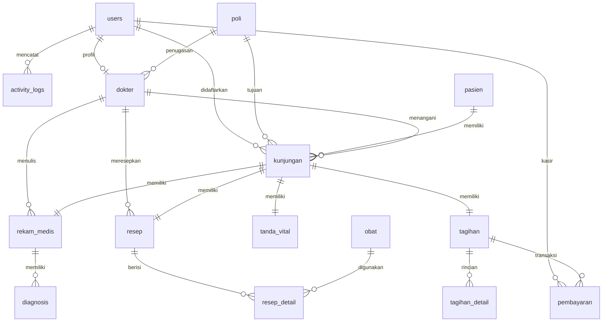

# Sistem Informasi Klinik

Aplikasi web manajemen operasional klinik rawat jalan berbasis Laravel 12 & PHP 8.4. Menangani alur pendaftaran pasien, antrean poli, rekam medis SOAP, peresepan obat, kasir/penagihan, dan audit log aktivitas pengguna.

---

## Daftar Isi
- [Peran Pengguna](#peran-pengguna)
- [Alur Kerja Sistem](#alur-kerja-sistem)
- [Relasi Tabel (ERD)](#relasi-tabel-erd)
- [Struktur Folder](#struktur-folder)
- [TODO & Status Fitur](#todo--status-fitur)
- [Info Penting & Panduan Menjalankan](#info-penting--panduan-menjalankan)

---

## Peran Pengguna

| Role | Tanggung Jawab Utama |
|---|---|
| **Admin** | Kelola akun pengguna (admin, dokter, resepsionis) dan audit log aktivitas HTTP. |
| **Resepsionis** | Pendaftaran pasien, pencarian rekam medis, antrean poli, kasir/pembayaran, cetak kuitansi, monitoring stok obat (read-only). |
| **Dokter** | Anamnesis, rekam medis SOAP, diagnosis ICD-10, dan peresepan obat (e-prescription). |

---

## Alur Kerja Sistem

```
Pasien Datang
      ↓
[Resepsionis] Pendaftaran Pasien (Auto No. RM)
      ↓
[Resepsionis] Buat Kunjungan Poli (Auto No. Antrean & Tagihan Dasar)
      ↓
[Resepsionis / Perawat] Catat Tanda Vital (Tensi, Suhu, BB, TB, IMT)
      ↓
[Dokter] Pemeriksaan, Rekam Medis (SOAP), Diagnosis ICD-10, Resep Obat
      ↓
[Kasir / Resepsionis] Pembayaran Tagihan (Tunai / Transfer / QRIS) & Cetak Kuitansi
      ↓
[Farmasi] Validasi & Penyerahan Obat ke Pasien
```

---

## Relasi Tabel (ERD)



### Penjelasan Relasi Kunci
- `users`: Induk autentikasi. Relasi 1-to-1 ke `dokter` (jika user adalah dokter), 1-to-N ke `activity_logs`.
- `pasien`: Data identitas pasien (`no_rm` unik, NIK, penjamin). Relasi 1-to-N ke `kunjungan`.
- `kunjungan`: Pusat operasional. Menghubungkan `pasien`, `dokter`, `poli`, dan `users` (resepsionis pendaftar). Memiliki relasi 1-to-1 dengan `tanda_vital`, `rekam_medis`, `resep`, dan `tagihan`.
- `rekam_medis`: Format SOAP (Subjective, Objective, Assessment, Plan). Memiliki status kunci (`is_locked`) dan relasi 1-to-N ke `diagnosis` (ICD-10).
- `resep` & `obat`: `resep` memiliki banyak item di `resep_detail` yang berelasi dengan master `obat`.
- `tagihan` & `pembayaran`: `tagihan` terbuat otomatis saat kunjungan didaftarkan, memiliki rincian biaya di `tagihan_detail`, dan dilunasi lewat `pembayaran` (kasir tercatat ke `users`).

---

## Struktur Folder

```
sistemklinik/
├── app/
│   ├── Http/
│   │   ├── Controllers/
│   │   │   ├── Admin/              # UserController, LogController
│   │   │   ├── Auth/               # Autentikasi Breeze
│   │   │   └── Resepsionis/        # Dashboard, Pasien, Kunjungan, Obat, Tagihan
│   │   └── Middleware/
│   │       ├── EnsureRole.php      # Guard otorisasi role
│   │       └── LogActivity.php     # Audit log aktivitas request HTTP
│   └── Models/                     # User, Pasien, Dokter, Poli, Kunjungan, RekamMedis,
│                                   # TandaVital, Diagnosis, Obat, Resep, Tagihan, dll.
├── database/
│   ├── migrations/                 # Skema 15+ tabel operasional klinik
│   └── seeders/
│       ├── DatabaseSeeder.php
│       └── KlinikSeeder.php        # Akun default, master obat, poli, dokter, dummy pasien
├── resources/
│   └── views/
│       ├── admin/                  # Blade UI admin (user & log aktivitas)
│       ├── resepsionis/            # Blade UI pasien, kunjungan, tagihan, obat
│       ├── components/             # Komponen Blade reusable (datatable, button, modal, dll.)
│       └── layouts/                # Master layout & navigasi
├── routes/
│   ├── web.php                     # Definisi route klinik & role grouping
│   └── auth.php                    # Route autentikasi Breeze
└── tests/
    └── Feature/
        ├── AdminTest.php           # Pest tests modul admin
        └── ResepsionisTest.php     # Pest tests modul resepsionis
```

---

## TODO & Status Fitur

### Selesai (Completed)
- [x] Autentikasi & session guard (Laravel Breeze).
- [x] Role-based access control (`admin`, `resepsionis`, `dokter`).
- [x] Modul Admin:
  - [x] CRUD User & proteksi penghapusan akun sendiri.
  - [x] Audit activity log HTTP dengan filter role, status, dan pencarian.
- [x] Modul Resepsionis:
  - [x] CRUD Pasien & auto-redirect pencarian `no_rm` / NIK.
  - [x] Pendaftaran kunjungan poli & generator format no antrean per poli/tanggal.
  - [x] Manajemen status kunjungan (`menunggu`, `dipanggil`, `diperiksa`, `selesai`, `batal`).
  - [x] Kasir: Rincian tagihan, pembayaran (tunai/transfer/QRIS), dan cetak kuitansi.
  - [x] Katalog obat read-only & pemantauan stok.
- [x] Skema database lengkap (Poli, Dokter, Pasien, Kunjungan, Tanda Vital, Rekam Medis, Resep, Tagihan, Pembayaran).
- [x] Seeder data awal lengkap (`KlinikSeeder`).
- [x] Automated feature tests via Pest.

### Rencana Pengembangan (TODO / Backlog)
- [ ] **Modul Dokter**:
  - [ ] Dashboard antrean periksa dokter (`dokter.dashboard`).
  - [ ] Input pemeriksaan tanda vital lanjutan.
  - [ ] Form pengisian SOAP rekam medis & mekanisme penguncian catatan medis (`is_locked`).
  - [ ] Input diagnosis dengan autocomplete kode ICD-10.
  - [ ] Pembuatan resep elektronik (e-prescribing).
- [ ] **Modul Farmasi / Apotek**:
  - [ ] Antrean peracikan resep masuk.
  - [ ] Dispensing & perubahan status resep (`diproses`, `diserahkan`).
  - [ ] Otomatisasi pengurangan stok obat saat penyerahan resep.
  - [ ] Manajemen inventaris obat (stok masuk, supplier, alert stok minimum).
- [ ] **Integrasi Tagihan Otomatis**:
  - [ ] Sinkronisasi otomatis item resep dokter ke `tagihan_detail`.
  - [ ] Dukungan tarif tindakan medis non-konsultasi.
- [ ] **Laporan & Ekspor**:
  - [ ] Laporan kunjungan harian & bulanan.
  - [ ] Laporan pendapatan & rekonsiliasi kasir.
  - [ ] Laporan morbiditas / 10 besar penyakit ICD-10.
  - [ ] Laporan mutasi & pemakaian obat.
- [ ] **Integrasi Eksternal**:
  - [ ] Bridging API BPJS Kesehatan (PCare).
  - [ ] Bridging platform Kemenkes SATUSEHAT (FHIR).

---

## Info Penting & Panduan Menjalankan

### Tech Stack
- **Backend**: Laravel 12 (PHP 8.3 / 8.4)
- **Frontend**: Blade + Tailwind CSS v4 + Alpine.js
- **Database**: SQLite (default lokal) / MySQL / PostgreSQL
- **Testing**: Pest PHP v5

### Kredensial Default (Seeder)
Password semua akun: `password`

| Role | Email | Akses Utama |
|---|---|---|
| Admin | `admin@klinik.com` | `/admin/user`, `/admin/log`, seluruh rute resepsionis |
| Resepsionis | `resepsionis@klinik.com` | `/resepsionis`, `/pasien`, `/kunjungan`, `/tagihan`, `/obat` |
| Dokter | `dokter@klinik.com` | Alur pemeriksaan dokter |

### Cara Menjalankan

1. Setup dependensi dan database:
   ```bash
   composer run setup
   ```

2. Isi data awal:
   ```bash
   php artisan db:seed
   ```

3. Jalankan server lokal:
   ```bash
   composer run dev
   ```

4. Jalankan pengujian:
   ```bash
   php artisan test --compact
   ```
