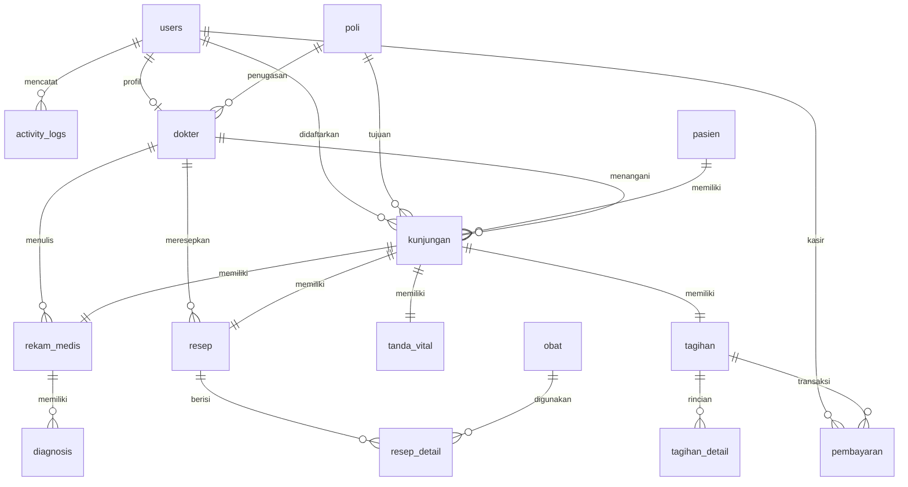

# Sistem Informasi Klinik

Aplikasi web manajemen operasional klinik rawat jalan berbasis Laravel 12 & PHP 8.4. Menangani alur pendaftaran pasien, antrean poli, rekam medis SOAP, peresepan obat, kasir/penagihan, dan audit log aktivitas pengguna.

---

## Daftar Isi
- [Peran Pengguna](#peran-pengguna)
- [Alur Kerja Sistem](#alur-kerja-sistem)
- [Relasi Tabel (ERD)](#relasi-tabel-erd)
- [Struktur Folder](#struktur-folder)
- [TODO & Status Fitur](#todo--status-fitur)
- [Info Penting & Panduan Menjalankan](#info-penting--panduan-menjalankan)

---

## Peran Pengguna

| Role | Tanggung Jawab Utama |
|---|---|
| **Admin** | Kelola akun pengguna (admin, dokter, resepsionis), master data poli, dan audit log aktivitas HTTP. |
| **Resepsionis** | Pendaftaran pasien, pencarian rekam medis, antrean poli, kasir/pembayaran, cetak kuitansi, monitoring stok obat (read-only). |
| **Dokter** | Antrean pemeriksaan, tanda vital (auto IMT), rekam medis SOAP, diagnosis ICD-10, riwayat medis, dan e-prescribing terintegrasi tagihan kasir. |

---

## Alur Kerja Sistem

```
Pasien Datang
      ↓
[Resepsionis] Pendaftaran Pasien (Auto No. RM)
      ↓
[Resepsionis] Buat Kunjungan Poli (Auto No. Antrean & Tagihan Dasar)
      ↓
[Resepsionis / Perawat] Catat Tanda Vital (Tensi, Suhu, BB, TB, IMT)
      ↓
[Dokter] Pemeriksaan, Rekam Medis (SOAP), Diagnosis ICD-10, Resep Obat
      ↓
[Kasir / Resepsionis] Pembayaran Tagihan (Tunai / Transfer / QRIS) & Cetak Kuitansi
      ↓
[Farmasi] Validasi & Penyerahan Obat ke Pasien
```

---

## Relasi Tabel (ERD)



### Penjelasan Relasi Kunci
- `users`: Induk autentikasi. Relasi 1-to-1 ke `dokter` (jika user adalah dokter), 1-to-N ke `activity_logs`.
- `pasien`: Data identitas pasien (`no_rm` unik, NIK, penjamin). Relasi 1-to-N ke `kunjungan`.
- `kunjungan`: Pusat operasional. Menghubungkan `pasien`, `dokter`, `poli`, dan `users` (resepsionis pendaftar). Memiliki relasi 1-to-1 dengan `tanda_vital`, `rekam_medis`, `resep`, dan `tagihan`.
- `rekam_medis`: Format SOAP (Subjective, Objective, Assessment, Plan). Memiliki status kunci (`is_locked`) dan relasi 1-to-N ke `diagnosis` (ICD-10).
- `resep` & `obat`: `resep` memiliki banyak item di `resep_detail` yang berelasi dengan master `obat`.
- `tagihan` & `pembayaran`: `tagihan` terbuat otomatis saat kunjungan didaftarkan, memiliki rincian biaya di `tagihan_detail`, dan dilunasi lewat `pembayaran` (kasir tercatat ke `users`).

---

## Struktur Folder

```
sistemklinik/
├── app/
│   ├── Http/
│   │   ├── Controllers/
│   │   │   ├── Admin/              # UserController, LogController, PoliController
│   │   │   ├── Auth/               # Autentikasi Breeze
│   │   │   ├── Dokter/             # DashboardController, PemeriksaanController
│   │   │   └── Resepsionis/        # Dashboard, Pasien, Kunjungan, Obat, Tagihan
│   │   └── Middleware/
│   │       ├── EnsureRole.php      # Guard otorisasi role
│   │       └── LogActivity.php     # Audit log aktivitas request HTTP
│   └── Models/                     # User, Pasien, Dokter, Poli, Kunjungan, RekamMedis,
│                                   # TandaVital, Diagnosis, Obat, Resep, Tagihan, dll.
├── database/
│   ├── migrations/                 # Skema 20+ tabel operasional klinik
│   └── seeders/
│       ├── DatabaseSeeder.php
│       └── KlinikSeeder.php        # Akun default, master obat, poli, dokter, dummy pasien
├── resources/
│   ├── css/                        # Tailwind CSS v4 design tokens & touch utilities
│   └── views/
│       ├── admin/                  # Blade UI admin (user, log aktivitas, master poli)
│       ├── dokter/                 # Blade UI dokter (antrean, pemeriksaan SOAP, e-resep)
│       ├── resepsionis/            # Blade UI pasien, kunjungan, tagihan, obat
│       ├── components/             # Komponen Blade reusable (datatable, button, modal, status-pill, allergy-banner, dll.)
│       └── layouts/                # Master layout responsif mobile-first (drawer off-canvas, topbar, desktop sidebar)
├── routes/
│   ├── web.php                     # Definisi route klinik & role grouping
│   └── auth.php                    # Route autentikasi Breeze
└── tests/
    └── Feature/
        ├── AdminPoliTest.php       # Pest tests master poli admin
        ├── AdminTest.php           # Pest tests modul admin (user, audit log)
        ├── DokterTest.php          # Pest tests modul antrean, SOAP, ICD-10, & e-resep dokter
        ├── ResepsionisTest.php     # Pest tests modul pasien, antrean, tagihan, obat
        └── Frontend/               # Pest tests kontrak desain mobile-first & audit anti-slop
```

---

## TODO & Status Fitur

### Selesai (Completed)
- [x] Autentikasi & session guard (Laravel Breeze).
- [x] Role-based access control (`admin`, `resepsionis`, `dokter`).
- [x] **Desain Antarmuka Mobile-First & Anti-Slop UI (DESIGN.md)**:
  - [x] Design tokens terstandarisasi: Slate-900 typography, Medical Teal accent, status semantik, matte surfaces.
  - [x] Standar sentuh mobile 44px+ (`@media (pointer: coarse)`), isolasi horizontal scroll table, off-canvas navigation drawer.
  - [x] Komponen patient safety: Sticky Patient Header, 3-state Allergy Banner, dialog konfirmasi eksplisit.
  - [x] Automated Design Gate Audit mengeliminasi seluruh pola AI-slop (banned emojis, looping pulse, dekorasi panah, dsb.).
- [x] **Modul Admin**:
  - [x] CRUD User & proteksi penghapusan akun sendiri.
  - [x] CRUD Master Poli (kode poli, nama poli, deskripsi, status aktif).
  - [x] Audit activity log HTTP dengan filter role, status kode, dan pencarian IP/URL/User.
- [x] **Modul Resepsionis & Kasir**:
  - [x] CRUD Pasien & auto-redirect pencarian `no_rm` / NIK.
  - [x] Pendaftaran kunjungan poli & generator format no antrean per poli/tanggal.
  - [x] Manajemen status kunjungan (`menunggu`, `dipanggil`, `diperiksa`, `selesai`, `batal`).
  - [x] Kasir: Rincian tagihan terpadu, pembayaran multi-metode (tunai/transfer/QRIS), dan cetak kuitansi.
  - [x] Katalog obat read-only & pemantauan ketersediaan stok.
- [x] **Modul Dokter & Rekam Medis**:
  - [x] Dashboard antrean periksa dokter real-time per poli/tanggal (`dokter.dashboard`).
  - [x] Pencatatan tanda vital lengkap & kalkulasi otomatis IMT (Indeks Massa Tubuh).
  - [x] Form pengisian rekam medis SOAP (Subjective, Objective, Assessment, Plan).
  - [x] Mekanisme penguncian catatan medis (`is_locked` & `locked_at`).
  - [x] Input diagnosis dengan autocomplete kode ICD-10 (primer & sekunder).
  - [x] Pembuatan resep elektronik (e-prescribing) dengan dosis, frekuensi, dan aturan pakai.
  - [x] Sinkronisasi otomatis resep dokter ke rincian tagihan kasir (`tagihan_detail`).
  - [x] Pengurangan otomatis stok obat saat resep difinalisasi.
  - [x] Riwayat rekam medis dan pengobatan pasien sebelumnya.
- [x] Skema database lengkap (Poli, Dokter, Pasien, Kunjungan, Tanda Vital, Rekam Medis, Diagnosis ICD-10, Obat, Resep, Resep Detail, Tagihan, Tagihan Detail, Pembayaran, Activity Log).
- [x] Seeder data awal komprehensif (`KlinikSeeder`).
- [x] Automated testing lengkap via Pest PHP (108 tests / 751 assertions, 100% lulus).

### Rencana Pengembangan (TODO / Backlog)
- [ ] **Modul Farmasi / Apotek Khusus**:
  - [ ] Antrean peracikan resep masuk untuk petugas farmasi.
  - [ ] Alur dispensing & status resep terpisah (`draft` → `diproses` → `diserahkan`).
  - [ ] Verifikasi telaah resep (dosis, alergi, duplikasi) oleh farmasis.
  - [ ] Manajemen inventaris obat (stok masuk, supplier, tanggal kedaluwarsa, alert stok minimum).
- [ ] **Fitur Pelengkap Kasir & Resepsionis**:
  - [ ] Cetak nomor antrean / tiket fisik pendaftaran.
  - [ ] Pembatalan pembayaran / void tagihan kasir berotorisasi.
  - [ ] Tarif tindakan medis non-konsultasi (misal: EKG, nebulizer, jahit luka).
- [ ] **Laporan & Ekspor (Reporting)**:
  - [ ] Laporan kunjungan harian & bulanan (rekap pasien, filter poli, tren kunjungan).
  - [ ] Laporan pendapatan & rekonsiliasi kas kasir (tunai vs transfer vs QRIS).
  - [ ] Laporan morbiditas / 10 besar penyakit ICD-10.
  - [ ] Laporan mutasi & pemakaian obat.
  - [ ] Ekspor data laporan ke format Excel/CSV & PDF.
- [ ] **Integrasi Eksternal**:
  - [ ] Bridging API BPJS Kesehatan (PCare).
  - [ ] Bridging platform Kemenkes SATUSEHAT (FHIR).

---

## Info Penting & Panduan Menjalankan

### Tech Stack
- **Backend**: Laravel 12 (PHP 8.3 / 8.4)
- **Frontend**: Blade + Tailwind CSS v4 + Alpine.js
- **Database**: SQLite (default lokal) / MySQL / PostgreSQL
- **Testing**: Pest PHP v5

### Kredensial Default (Seeder)
Password semua akun: `password`

| Role | Email | Akses Utama |
|---|---|---|
| Admin | `admin@klinik.com` | `/admin/user`, `/admin/log`, seluruh rute resepsionis |
| Resepsionis | `resepsionis@klinik.com` | `/resepsionis`, `/pasien`, `/kunjungan`, `/tagihan`, `/obat` |
| Dokter | `dokter@klinik.com` | Alur pemeriksaan dokter |

### Cara Menjalankan

1. Setup dependensi dan database:
   ```bash
   composer run setup
   ```

2. Isi data awal:
   ```bash
   php artisan db:seed
   ```

3. Jalankan server lokal:
   ```bash
   composer run dev
   ```

4. Jalankan pengujian:
   ```bash
   php artisan test --compact
   ```
